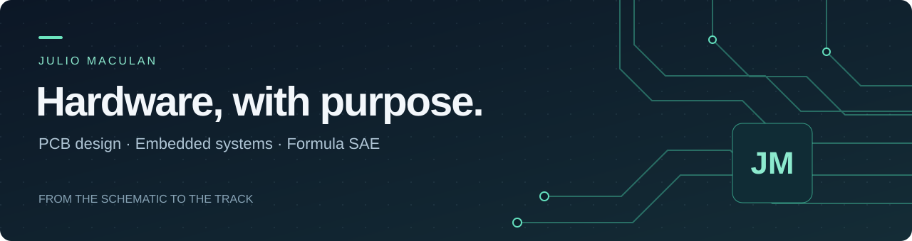

### Hi, I'm Julio 👋

I'm an engineering student at **Télécom Paris** and the **University of São Paulo**, with hands-on experience developing electronics for **EESC-USP Tupã's Formula SAE vehicle**.

I enjoy turning a schematic into a board that works in the real world — from power distribution and measurement to displays and vehicle safety circuits.

**[Explore my PCB portfolio ↗](https://juliomacmac.github.io)** &nbsp; · &nbsp; **[Connect on LinkedIn ↗](https://www.linkedin.com/in/julio-maculan/)**

---

### From the schematic to the track

#### ⚡ Power Distribution Module
**4-layer PCB · STM32G4 · CAN**

Electronic power distribution, high-side switching and current measurement for the Formula SAE vehicle.

I designed the **schematic and PCB** and guided the firmware logic; a teammate implemented the firmware. The board was **manufactured, tested and installed in the vehicle**.

[Explore the board, schematics & 3D viewer →](https://juliomacmac.github.io/pdm.html)

 

### More boards, more challenges

<table>
<tr>
<td width="50%" valign="top">

<h4>ShieldESP display</h4>

An ESP32-based board for the vehicle display. Hardware development and display interface.

<a href="https://juliomacmac.github.io/display.html">See the display board →</a>
</td>
<td width="50%" valign="top">

<h4>Brake System Plausibility Device</h4>

Hardware logic for brake and power plausibility checks. Schematic and PCB design.

<a href="https://juliomacmac.github.io/bspd.html">See the safety circuit →</a>
</td>
</tr>
</table>

### What I work with

| Design | Embedded hardware | Vehicle electronics |
| :--- | :--- | :--- |
| Altium Designer · Schematics · Multilayer PCBs | STM32 · ESP32 · CAN | Power distribution · Current measurement · Safety circuits |

### Let's connect

Interested in PCB design, embedded systems or vehicle electronics? I'd be happy to exchange ideas.

**[Portfolio](https://juliomacmac.github.io) · [LinkedIn](https://www.linkedin.com/in/julio-maculan/)**

Built with curiosity. Refined through testing.

