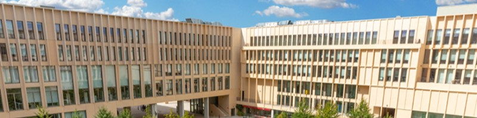

# Julio Maculan

**Electrical engineering · USP × Télécom Paris**

Hi! I'm Julio, an electrical engineering student pursuing a double degree at the **University of São Paulo** and **Télécom Paris**.

At **EESC-USP Tupã**, I developed electronics for an electric Formula SAE car and served as Electrical Director. My interests span PCB design, embedded systems and microelectronics.

[LinkedIn](https://www.linkedin.com/in/julio-maculan/) &nbsp; · &nbsp; [PCB portfolio](https://juliomacmac.github.io)

---

## Power Distribution Module

**T11 · EESC-USP Tupã · Formula SAE**

A **four-layer PCB** for distributing power throughout the vehicle, combining high-side switching, current measurement and CAN communication around an **STM32G4**.

I designed the schematic and PCB and guided the firmware logic, which a teammate implemented. The board was **manufactured, tested and installed in the car**.

**[Explore the PDM →](https://juliomacmac.github.io/pdm.html)**  
Schematics, copper layers and an interactive 3D viewer.

 

